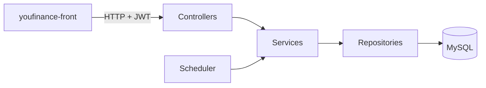

# YouFinance · Backend

API REST de **YouFinance**, una aplicación de finanzas personales: cuentas, movimientos, gastos recurrentes, deudas, inversiones, presupuestos y evolución del patrimonio.


> [!NOTE]
> El frontend está en **[youfinance-front](https://github.com/Jodrix15/youfinance-front)**.

## Índice

- [Funcionalidades](#funcionalidades)
- [Tecnologías](#tecnologías)
- [Arquitectura](#arquitectura)
- [Cómo ejecutarlo](#cómo-ejecutarlo)
- [Entornos y despliegue](#entornos-y-despliegue)
- [Documentación](#documentación)

## Funcionalidades

| Módulo | Qué hace |
|---|---|
| Autenticación | Registro, login y logout con JWT; perfil, contraseña y preferencias del usuario |
| Cuentas | Cuentas bancarias y de inversión, con su saldo y rendimiento |
| Movimientos | Ingresos, gastos y transferencias, clasificados por categoría |
| Gastos recurrentes | Pagos periódicos con fecha de inicio y de fin |
| Deudas | Préstamos con su fecha de inicio y lo pendiente |
| Inversiones | Activos con su precio y evolución |
| Presupuestos | Límites de gasto por categoría |
| Dashboard | Patrimonio neto, flujo de caja, gastos por categoría y evolución histórica |
| Logros | Hitos que el usuario desbloquea al usar la app |

Una tarea programada guarda cada cierto tiempo una foto del patrimonio para poder ver su evolución.

## Tecnologías

| Capa | Tecnología |
|---|---|
| Lenguaje | Java 21 |
| Framework | Spring Boot 4 (Web, Data JPA, Validation) |
| Seguridad | Spring Security + JWT (jjwt) |
| Base de datos | MySQL, con migraciones de Flyway |
| Utilidades | Lombok |
| Despliegue | Docker y Render |

## Arquitectura



```
src/main/java/com/example/finanzas/
├── config/        Seguridad, JWT y datos iniciales
├── controller/    Endpoints REST (/api/...)
├── dto/           Objetos de entrada y salida
├── model/         Entidades JPA
├── repository/    Acceso a datos
├── scheduler/     Foto periódica del patrimonio
└── service/       Lógica de negocio
```

Las migraciones de la base de datos están en `src/main/resources/db/migration/` y se aplican solas al arrancar.

## Cómo ejecutarlo

**Requisitos:** Java 21 y una base de datos MySQL.

1. Define las variables de entorno:

   | Variable | Ejemplo |
   |---|---|
   | `DATASOURCE_URL` | `mysql://localhost:3306/finanzas` |
   | `DATASOURCE_USERNAME` | `root` |
   | `DATASOURCE_PASSWORD` | tu contraseña |
   | `JWT_SECRET` | una cadena larga y aleatoria |
   | `EXPIRATION_TOKEN` | `86400000` (24 h en milisegundos) |

2. Arranca la aplicación:

   ```bash
   ./mvnw spring-boot:run
   ```

La API queda en `http://localhost:8080`.

## Entornos y despliegue

| Rama | Entorno | Dónde |
|---|---|---|
| `develop` | Pruebas (UAT) | Render |
| `main` | Producción | Render |
| `local` | Desarrollo en local | Tu ordenador |

La configuración de Render está en `render.yaml`. Los secretos no se suben al repositorio: se configuran en el panel de Render.

## Documentación

- Modelo entidad-relación: [`docs/modelo_er.mermaid`](docs/modelo_er.mermaid)
- Guía de seguridad: [`SECURITY_GUIDE.md`](SECURITY_GUIDE.md)
- Apuntes de controllers en Spring: [`docs/apuntes_spring_controllers.html`](docs/apuntes_spring_controllers.html)

---

🤖 Desarrollado con ayuda de [Claude](https://claude.ai) como asistente de programación.
